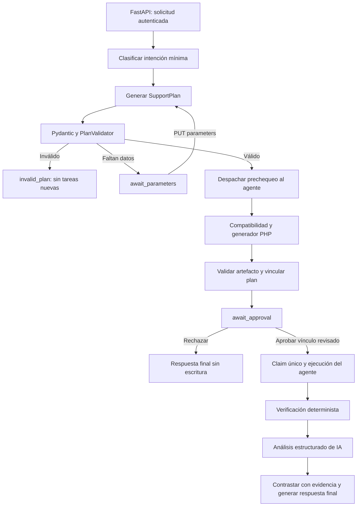

# Arquitectura de IA integrada al MVP ECMP

## Inspección previa y alcance

Se revisaron el inventario del repositorio, Git, FastAPI, LangGraph, servicios,
contratos compartidos, agente, integración PHP y documentación. No se encontraron
AGENTS.md en el repositorio ni los ancestros examinados. La línea base fue
**77 pruebas aprobadas, 1 omitida** (laboratorio real), con una advertencia de
deprecación de Starlette/AnyIO. Se conservaron los cambios locales y archivos
sin seguimiento; no se hicieron commits, resets ni una reconstrucción del proyecto.

Ya existían clasificación ECMP, flujo durable por eventos, generación PHP, validación
de artefactos, aprobación vinculada, polling, claim único y verificación determinista.
Se completan planificación, política del plan, estado tipado y evaluación de resultados.
La implementación usa las mismas versiones: OpenAI 1.82.0, LangGraph 0.4.8,
Pydantic 2.11.4 y FastAPI 0.115.12. No hay dependencias ni infraestructura nuevas.

El alcance continúa siendo ECMP. Las acciones de impresoras/Windows del ejemplo
no existen en el catálogo y se rechazan. Tampoco se habilitan escrituras RouterOS
reales ni una variante v7. El diagnóstico portátil y PHP quedan intactos.

## Distribución de responsabilidades

| Componente | Responsabilidad |
|---|---|
| `shared/contracts.py` | Request, Result, Parameters, catálogo ACTIONS y controles existentes |
| `server/app/services/ai.py` | AIService (protocolo), Interpreter, proveedor OpenAI y simulación explícita |
| `server/app/ai/models.py` | ProblemClassification, PlannedAction, SupportPlan, ResultAnalysis, FinalSupportResponse y estado Pydantic |
| `server/app/ai/prompts.py` | Instrucciones de clasificación, planificación y análisis; catálogo desde ACTIONS |
| `server/app/ai/policy.py` | Validación determinista e integridad del plan antes de despachar/aprobar/consumir permisos |
| `server/app/ai/results.py` | Evidencia mínima, límites del análisis, respuesta final y estado de espera |
| `server/app/workflow.py` | Grafo LangGraph extendido, con pausas del workflow existente |
| `server/app/services/operations.py` | Persistencia, tareas, autenticación, aprobación, resultados y recuperación |
| `agent/app/runner.py` | Ejecución de las acciones autorizadas y controles locales existentes |

SupportRequest y ActionResult son alias de Request y Result, no esquemas duplicados.
ActionObservation resume el resultado con task_id y action_id para correlacionarlo;
no sustituye el resultado completo y su snapshot ya guardados en la tarea.

WorkflowState y WorkflowRecord usan Pydantic. El registro valida clasificación,
plan, resultados, respuesta, aprobaciones y pendientes. Conserva campos adicionales
del workflow anterior para mantener los contratos de artefactos y checkpoints.
Los modelos que recibe la IA sí prohíben campos extra y coerciones de tipos.

## Flujo y pausas



WAITING_APPROVAL se representa mediante el estado existente `await_approval`.
No se agrega otro endpoint de aprobación ni un proceso esperando en memoria.
SQLite guarda estado, tareas y auditoría atómicamente por evento; la próxima
solicitud autenticada reanuda el grafo. El reinicio conserva la espera y el plan.

El máximo es **3 acciones** y no hay replanificación autónoma. Completar parámetros
es el único evento que vuelve a generar un plan antes de despachar; después se
bloquea su edición. Cada invocación del grafo tiene límite de 20 pasos. Los fallos
de clasificación/planificación terminan sin tareas; no hay fallback al simulador.

## Contrato de planificación y seguridad

Ejemplo de acción dentro de un plan:

```json
{
  "action_id": "apply_approved_ecmp",
  "parameters": {},
  "reason": "Aplicar el artefacto solo tras aprobacion humana.",
  "risk_level": "REQUIRES_APPROVAL",
  "requires_approval": true
}
```

En este MVP `parameters` es un objeto **vacío y cerrado**: la IA no suministra
direcciones, destinos, comandos, scripts, tokens ni artefactos. Operations vincula
el formulario Parameters validado y la representación generada por PHP a la tarea.
El texto explicativo del modelo es descriptivo; nunca se interpreta como código.

PlanValidator comprueba categoría, datos faltantes, estado, catálogo, riesgo,
aprobación y orden. El único plan listo válido es:

1. `get_ecmp_precheck`: READ_ONLY, sin aprobación de escritura.
2. `apply_approved_ecmp`: REQUIRES_APPROVAL, aprobación obligatoria.
3. `verify_ecmp`: READ_ONLY.

Se rechazan acciones inventadas, comandos en campos nuevos o parámetros, coerciones,
duplicados, más de tres acciones, cambios de orden y reducción del riesgo.
Un plan `needs_information` contiene cero acciones y solicita `ecmp_parameters`;
el técnico completa el formulario existente. Un plan fuera del alcance no contiene acciones.

El hash del plan se añade al vínculo de aprobación de las solicitudes nuevas.
Se revalida al despachar, aprobar y consumir el claim. El payload del agente se
construye con datos confiables del workflow, nunca copiando directamente el plan.
Los registros anteriores sin `ai_schema` conservan el flujo determinista previo
y sus aprobaciones; no se les inventa un plan retrospectivamente. La protección
de la base y el código frente a un administrador local sigue fuera del modelo de amenaza.

## Datos enviados al modelo y prompt injection

Se conserva la minimización anterior: la solicitud libre se transforma en ECMP u
OUT_OF_SCOPE mediante el vocabulario soportado. `original_request` guarda **esa
proyección**, no la frase original. No es un clasificador semántico abierto ni un
extractor de parámetros desde cualquier descripción: esas ampliaciones no forman
parte de esta entrega. Una solicitud ambigua/fuera del vocabulario no obtiene permisos.

OpenAI recibe únicamente la intención, la clasificación y un booleano indicando
si el formulario está completo. Para resultados recibe acciones/estados/códigos
y conteos de verificaciones. No recibe la frase original, las IP, nombres de routers,
identificadores de sesión/tarea, snapshots, script, tokens o contraseñas.

Los prompts son del sistema y los datos viajan separados como mensaje user JSON.
El filtrado léxico se usa únicamente para esta proyección de entrada; **no se extrae
JSON de la respuesta con regex ni bloques Markdown**. La autorización final depende
de políticas y del claim, aunque el proveedor produzca una salida maliciosa.

## OpenAI y pruebas sin consumo

Configuración existente en `server/.env`:

```dotenv
ECMP_AI_MODE=simulated
OPENAI_MODEL=gpt-4o-mini
OPENAI_API_KEY=
```

Para utilizar el proveedor real cambia ECMP_AI_MODE a `openai` y configura
OPENAI_API_KEY localmente. No envíes la clave en el chat ni la pongas en el formulario.
ECMP_AI_MODE es independiente de ECMP_MODE: puedes probar IA real con router simulado.
Sin clave, la primera operación de IA devuelve `ai_error`, código
`openai_api_key_missing` y un mensaje claro; salud, catálogo y arranque siguen disponibles.

Interpreter usa `client.beta.chat.completions.parse(response_format=ModeloPydantic)`,
la API disponible en **SDK 1.82.0**, con timeout de 20 s, cero reintentos y límite de
1800 tokens de salida. Se indica `store=False`. Los errores remotos, refusals,
truncamientos y fallos de validación se traducen a códigos sin reflejar cuerpos
del proveedor. La referencia oficial de [Structured Outputs](https://developers.openai.com/api/docs/guides/structured-outputs)
se contrastó con el SDK local para mantener la API correcta de esa versión.

Para sustituir la IA en pruebas, inyecta `interpreter=` en create_app/Operations
con classify_problem, generate_plan y analyze_results. `client_factory=` permite
probar el SDK real con httpx.MockTransport. La suite no usa servicios OpenAI reales.

## Interpretación y respuesta final

GET `/requests/{id}` conserva sus campos y añade clasificación, plan, plan_hash,
approved_actions, pending_actions, action_results, requires_approval, errors,
current_status y final_response. El campo `message` existente muestra el resumen,
por lo que la interfaz actual puede mostrarlo sin un rediseño.

El análisis de IA no puede convertir advertencias, fallos o incertidumbre en éxito.
Se contrasta con la verificación determinista. `problem_resolved` permanece false
porque aún no se prueban tráfico WAN ni conectividad LAN. El resumen diferencia
acciones correctas y fallidas; una lectura de verificación aceptada puede seguir
siendo fallida si falta configuración.

Si el análisis se rechaza o el proveedor falla después de ejecutar, se guarda
la evidencia y se devuelve `analysis_source=deterministic_fallback`, error_codes
y una explicación visible. No se repite la escritura. La recuperación por caducidad
es enteramente determinista y la reconciliación conserva intervención humana,
incluso si el modelo intenta sugerir éxito. Resultados duplicados no repiten el análisis.

## Observabilidad, validación y límites

El logger `ecmp.workflow` emite eventos INFO con request_id, nodo, clasificación,
acciones conocidas propuestas/rechazadas, transición, resultado y código de error.
La auditoría SQLite conserva los eventos para GET `/requests/{id}/audit`. Un nombre
de acción desconocida se registra como `unknown`; no se registran prompts completos,
explicaciones libres, snapshots, secretos ni mensajes crudos de excepciones externas.
Configura el nivel INFO del logger en el despliegue si quieres salida a consola;
la auditoría persistente no depende de esa configuración.

```powershell
.\.venv-mvp\Scripts\python.exe -m pytest -q
.\.venv-mvp\Scripts\python.exe -m pytest -q tests/integration/test_ai_architecture.py
```

Las pruebas nuevas cubren planes adversariales, inyección, permisos, integridad,
falta de datos/clave, HTTP simulado con SDK real, respuesta final, deduplicación,
reconciliación y compatibilidad de checkpoints. El E2E existente sigue utilizando
PHP y procesos reales, con IA y RouterOS simulados explícitamente.

No se ha validado una llamada facturable a OpenAI ni un router real. La persistencia
existente sigue siendo síncrona y monousuario: las llamadas externas se realizan
dentro de la transacción del evento, por lo que latencias altas pueden bloquear
otras operaciones y provocar caducidad conservadora. No se afirma escalabilidad
multiusuario; separar ese trabajo requiere una evolución de la coordinación durable.

### Resultado de la verificación local (03-10-2026)

Suite completa: **118 passed, 1 skipped, 1 warning in 30.09s**. Incluye 41 casos
nuevos de arquitectura de IA y los 77 anteriores, incluidos ambos E2E con procesos
y el ejecutable portátil existente. La omisión corresponde al laboratorio real no
habilitado; la advertencia es la deprecación preexistente de Starlette/AnyIO.
`pip check` no encontró dependencias rotas y `git diff --check` no encontró errores
de espacios (Git mantiene su advertencia de normalización LF/CRLF en `.gitignore`).
No se cambiaron locks, PHP, shared, el ejecutor del agente ni la interfaz gráfica.
